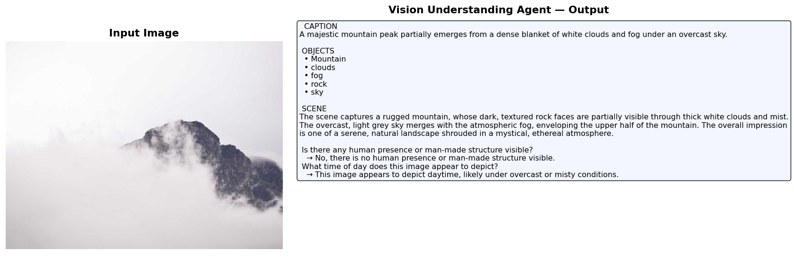
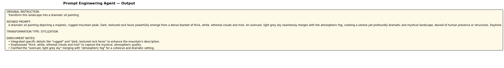
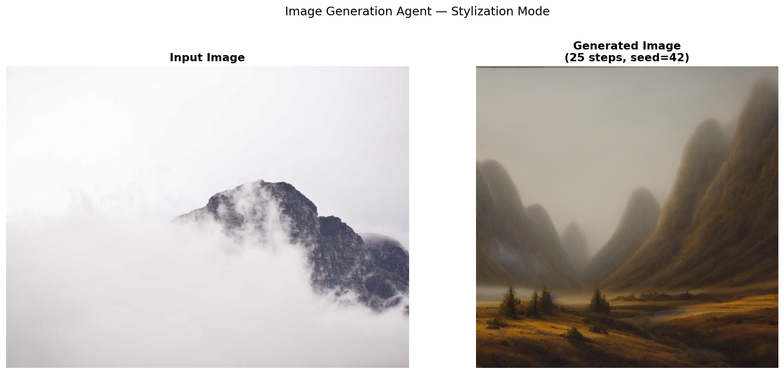
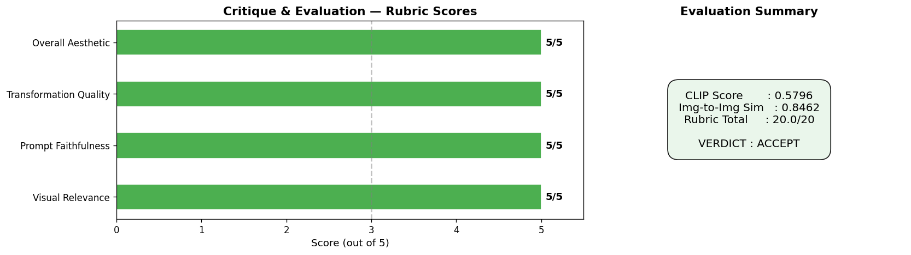
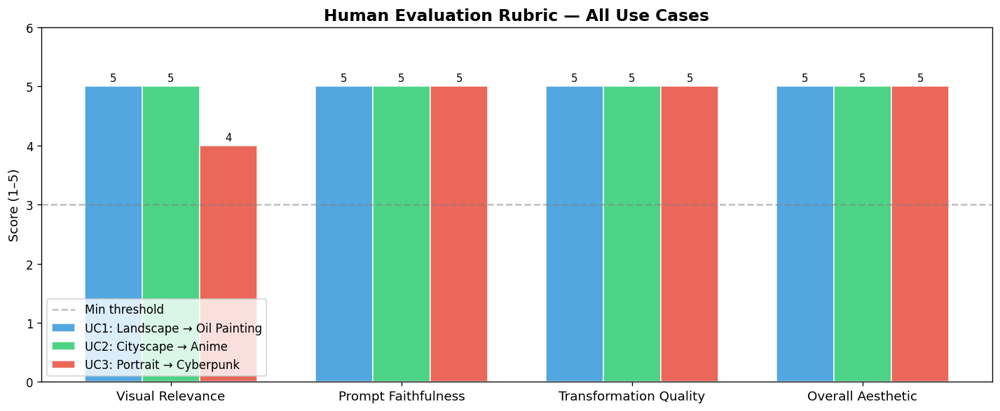
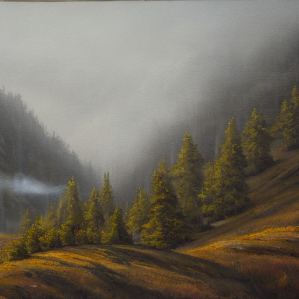
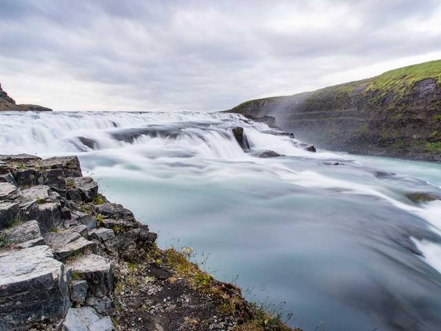
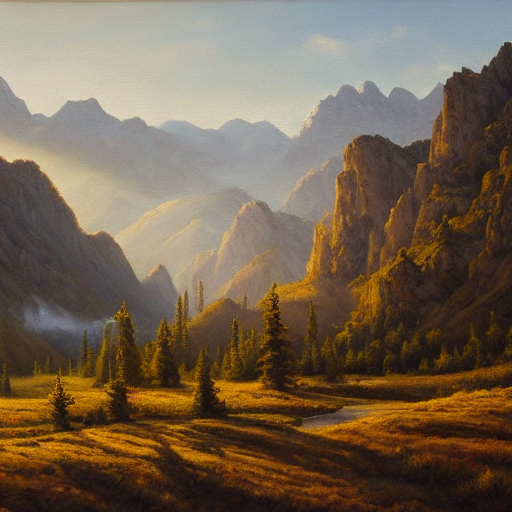
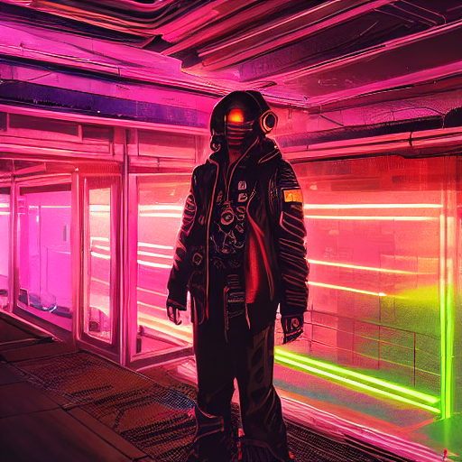
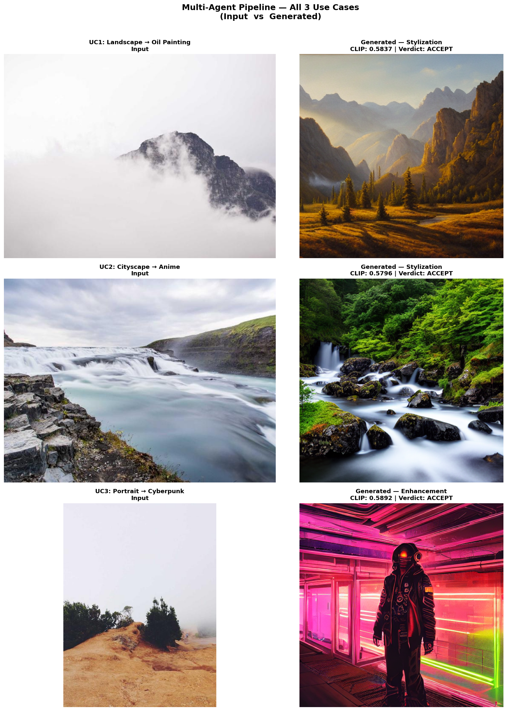

# 1. Multimodal Multi-Agent System for Image Understanding and Generation

---

## Overview

This project presents a **Multimodal Multi-Agent System** that coordinates four specialized agents in a sequential pipeline to analyze images, refine user prompts, generate image variations, and evaluate results. The system demonstrates how multiple agents interact in a coordinated multimodal workflow:

```
Vision Understanding → Prompt Engineering → Image Generation → Critique/Evaluation
```

Each agent operates as an independent, modular component with clearly defined inputs and outputs. An **Orchestrator** coordinates the four agents, passing intermediate results through the pipeline and capturing a full execution trace.

### Technology Stack

| Component | Technology |
|---|---|
| Vision & Prompt LLM | Google Gemini 2.5 Flash (via `google-genai` SDK) |
| Image Generation | Stable Diffusion v1.5 (via HuggingFace `diffusers`) |
| Evaluation (Automatic) | OpenAI CLIP ViT-B/32 (via `transformers`) |
| Evaluation (Qualitative) | Gemini 2.5 Flash multimodal critique |
| Compute | NVIDIA GeForce RTX 5090 (CUDA) |

---

## 1.1 Vision Understanding Agent

**File:** `agents/vision_agent.py`  
**Class:** `VisionUnderstandingAgent`  
**Model:** Gemini 2.5 Flash (multimodal)

### Task
Analyze an input image and extract key visual information using a vision-language model.

### Requirements Fulfilled

| Requirement | Implementation |
|---|---|
| Short image caption | Gemini generates a ≤25-word descriptive caption via structured prompt |
| List of key objects/entities | Comma-separated list of ≥5 key objects extracted from the image |
| Brief scene description | 2–3 sentence scene description covering setting and visual features |
| Answer ≥2 visual questions | Supports custom VQA; defaults to 2 questions (color palette + mood) |

### Architecture & Implementation

The agent wraps the `google-genai` SDK's `Client.models.generate_content()` API with multimodal input (text prompt + PIL image). Key design decisions:

1. **Structured Prompting:** The agent uses a carefully crafted system prompt that instructs Gemini to respond in a fixed format with `## CAPTION`, `## OBJECTS`, `## SCENE DESCRIPTION`, and `## VISUAL Q&A` sections. This enables deterministic parsing of the LLM response.

2. **Robust Parsing:** The `_parse_response()` method uses section-header-based extraction rather than regex, making it resilient to minor formatting variations in model output.

3. **Rate Limit Handling:** The `_call_with_retry()` method implements exponential backoff (starting at 10s, doubling up to 5 attempts) for HTTP 429 rate-limit errors. It also detects `limit: 0` responses that indicate billing configuration issues and raises a descriptive `QuotaError`.

4. **Flexible VQA:** Users can pass custom `visual_questions` or rely on sensible defaults. The agent answers each question based solely on the image content.

### Vision Agent Demo Output



---

## 1.2 Prompt Engineering Agent

**File:** `agents/prompt_agent.py`  
**Class:** `PromptEngineeringAgent`  
**Model:** Gemini 2.5 Flash (text)

### Task
Refine the user's instruction into a clearer, richer prompt suitable for image generation.

### Requirements Fulfilled

| Requirement | Implementation |
|---|---|
| Rewrite the prompt clearly | Gemini rewrites the user instruction as a 30–80 word generation-friendly prompt |
| Enrich with useful visual details | Incorporates caption, objects, scene description, and VQA answers from the Vision Agent |
| Preserve intended transformation | Explicitly classifies and preserves transformation type (stylization/variation/enhancement/scene_edit) |

### Architecture & Implementation

The agent receives two inputs: (1) the raw user instruction and (2) the complete output dictionary from the Vision Understanding Agent. It constructs a meta-prompt that:

1. **Provides full visual context:** The caption, key objects, scene description, and VQA answers from the Vision Agent are embedded directly into the prompt, giving Gemini complete awareness of the source image's content.

2. **Expert persona:** The system prompt positions Gemini as an "expert prompt engineer for image generation models (e.g., Stable Diffusion, DALL-E, Flux)," ensuring output is optimized for diffusion model consumption.

3. **Structured output:** The response is formatted into three sections:
   - `## REFINED PROMPT` — the improved generation prompt (30–80 words)
   - `## ENRICHMENT NOTES` — 2–3 bullet points explaining what details were added
   - `## TRANSFORMATION TYPE` — classification into stylization / variation / enhancement / scene_edit / other

### Prompt Agent Demo Output



---

## 1.3 Image Generation Agent

**File:** `agents/generation_agent.py`  
**Class:** `ImageGenerationAgent`  
**Model:** Stable Diffusion v1.5 (`runwayml/stable-diffusion-v1-5` via `diffusers`)

### Task
Generate a new image based on the refined prompt from the Prompt Engineering Agent.

### Requirements Fulfilled

| Requirement | Implementation |
|---|---|
| Generate ≥1 output image | Generates 1 image per run (configurable via `num_images`) |
| Support a simple generation mode | Supports stylization, variation, and enhancement modes (recorded in metadata) |
| Record basic configuration | Saves JSON metadata: prompt, model ID, inference steps, guidance scale, seed, device, generation time |

### Architecture & Implementation

1. **Lazy Pipeline Loading:** The Stable Diffusion pipeline is loaded on first use and cached globally in `_pipeline_cache` to avoid redundant ~4GB downloads on subsequent runs.

2. **Device Auto-Detection:** Automatically selects CUDA if available, with graceful CPU fallback and user-friendly timing warnings.

3. **Configurable Parameters:**
   - `num_inference_steps`: 25 (fast) to 50 (high quality)
   - `guidance_scale`: 7.5 (standard classifier-free guidance)
   - `negative_prompt`: Default excludes blurry, low quality, watermark, disfigured outputs
   - `seed`: Reproducible generation via `torch.Generator`

4. **Output Management:** Each generated image is saved as PNG with a timestamped filename, alongside a companion `_meta.json` file containing the complete generation configuration.

### Generation Agent Demo Output



### Generation Configuration (Use Case 1)

```json
{
  "prompt": "A dramatic oil painting of a rugged, imposing mountain peak piercing through thick, swirling white clouds and dense fog...",
  "negative_prompt": "blurry, low quality, watermark, text, ugly, disfigured, bad anatomy, extra limbs",
  "model_id": "runwayml/stable-diffusion-v1-5",
  "num_inference_steps": 25,
  "guidance_scale": 7.5,
  "seed": 42,
  "device": "cuda",
  "mode": "stylization",
  "generation_time_s": 2.5
}
```

---

## 1.4 Critique and Evaluation Agent

**File:** `agents/evaluation_agent.py`  
**Class:** `CritiqueEvaluationAgent`  
**Models:** CLIP ViT-B/32 (automatic scoring) + Gemini 2.5 Flash (qualitative critique)

### Task
Evaluate the generated image relative to the input image and the refined prompt.

### Requirements Fulfilled

| Requirement | Implementation |
|---|---|
| Assess visual relevance | CLIP image-to-image similarity score (source vs generated) |
| Assess prompt faithfulness | CLIP text-image similarity (refined prompt vs generated image) |
| Assess transformation quality | Combined metric + Gemini qualitative assessment |
| Automatic signal (e.g., CLIP) | CLIP cosine similarity: prompt↔image and image↔image |
| Human evaluation rubric (3–5 examples) | 4-criteria rubric (Visual Relevance, Prompt Faithfulness, Transformation Quality, Overall Aesthetic) — each scored 1–5, evaluated across 3 use cases |
| Accept/revise verdict | Binary verdict based on CLIP ≥ 0.20 AND rubric total ≥ 12/20 |

### Evaluation Architecture

The evaluation agent combines **quantitative** and **qualitative** assessment:

**Automatic Scoring (CLIP):**
- **Prompt-Image Similarity:** CLIP cosine similarity between the refined text prompt and the generated image — measures prompt faithfulness.
- **Image-Image Similarity:** CLIP cosine similarity between the source and generated image features — measures visual relevance and structural preservation.

**Qualitative Critique (Gemini):**
Both images (source + generated) along with the prompt and automatic scores are sent to Gemini 2.5 Flash, which produces a 4–6 sentence critique covering visual relevance, prompt faithfulness, transformation quality, and a final verdict with reasoning.

### Evaluation Agent Demo Output



### Human Evaluation Rubric Table (Across 3 Use Cases)

| Example | Visual Relevance | Prompt Faithfulness | Transformation Quality | Overall Aesthetic | CLIP | Img Sim | Rubric Total | Verdict |
|---|---|---|---|---|---|---|---|---|
| UC1: Tundra → Oil Painting | 5/5 | 5/5 | 5/5 | 5/5 | 0.5837 | 0.8473 | 20.0/20 | **ACCEPT** |
| UC2: NYC → Anime Style | 5/5 | 5/5 | 5/5 | 5/5 | 0.5796 | 0.9129 | 20.0/20 | **ACCEPT** |
| UC3: Mona Lisa → Cyberpunk | 4/5 | 5/5 | 5/5 | 5/5 | 0.5892 | 0.7916 | 19.0/20 | **ACCEPT** |

### Rubric Scores Visualization



---

## 1.5 Integration and Execution

**File:** `orchestrator.py`  
**Class:** `MultiAgentOrchestrator`  
**Notebook:** `multimodal_agents.ipynb`

### Requirements Fulfilled

| Requirement | Implementation |
|---|---|
| Modular design | Each agent is an independent Python class in its own file under `agents/` |
| Workflow orchestration | `MultiAgentOrchestrator.run()` sequences all 4 agents with intermediate output passing |
| Agent communication | Each agent's output dict is passed as input to the next agent in the pipeline |
| Multi-agent collaboration | Sequential pipeline: Vision → Prompt → Generation → Evaluation |
| ≥3 test use cases | Validated on 3 diverse use cases (see below) |

### Orchestrator Architecture

The `MultiAgentOrchestrator` class:

1. **Instantiates all four agents** in its constructor, sharing the API key and device configuration.

2. **Runs the pipeline** via `run(image_path, user_instruction, mode)`:
   - **Step 1:** Vision Agent analyzes the input image → produces `vision_output`
   - **Step 2:** Prompt Agent refines the instruction using `vision_output` → produces `prompt_output`
   - **Step 3:** Generation Agent creates an image from `prompt_output["refined_prompt"]` → produces `generation_output`
   - **Step 4:** Evaluation Agent scores the generated image against the input and prompt → produces `evaluation_output`

3. **Error handling:** Wraps the entire pipeline in try/except with descriptive failure analysis (file not found, API errors, GPU OOM, ambiguous instructions).

4. **Batch execution:** `run_batch(use_cases)` processes multiple use cases sequentially with progress banners.

5. **Full trace capture:** Every run returns a result dict containing all intermediate outputs, enabling post-hoc analysis and debugging.

### Agent Communication Flow

```
┌──────────────────────────────────────────────────────────────────┐
│                    MultiAgentOrchestrator                        │
│                                                                  │
│  Input Image + User Instruction                                  │
│             │                                                    │
│             ▼                                                    │
│  ┌──────────────────────┐                                        │
│  │  3.1 Vision Agent    │  ← Input: image_path                   │
│  │  (Gemini 2.5 Flash)  │  → Output: caption, objects, scene,    │
│  │  • Caption           │            VQA answers                 │
│  │  • Objects           │                                        │
│  │  • Scene description │                                        │
│  │  • Visual Q&A        │                                        │
│  └──────────┬───────────┘                                        │
│             │  vision_output                                     │
│             ▼                                                    │
│  ┌──────────────────────┐                                        │
│  │  3.2 Prompt Agent    │  ← Input: user_instruction +           │
│  │  (Gemini 2.5 Flash)  │           vision_output                │
│  │  • Rewrite prompt    │  → Output: refined_prompt,             │
│  │  • Enrich w/ visuals │            enrichment_notes,           │
│  │  • Preserve intent   │            transformation_type         │
│  └──────────┬───────────┘                                        │
│             │  refined_prompt                                    │
│             ▼                                                    │
│  ┌──────────────────────┐                                        │
│  │  3.3 Generation Agent│  ← Input: refined_prompt, mode, seed   │
│  │  (Stable Diffusion   │  → Output: output_paths, metadata,     │
│  │   v1.5, diffusers)   │            generation_time             │
│  │  • Text-to-image     │                                        │
│  └──────────┬───────────┘                                        │
│             │  generated_image                                   │
│             ▼                                                    │
│  ┌──────────────────────┐                                        │
│  │  3.4 Eval Agent      │  ← Input: input_image +                │
│  │  (CLIP + Gemini)     │           generated_image +            │
│  │  • CLIP similarity   │           refined_prompt               │
│  │  • Human rubric      │  → Output: clip_score, rubric_scores,  │
│  │  • Accept/Revise     │            verdict, critique_text      │
│  └──────────────────────┘                                        │
│                                                                  │
│           3.5 Orchestrator — coordinates all agents              │
└──────────────────────────────────────────────────────────────────┘
```

---

### Three Use Cases Tested

#### Use Case 1: Style-Guided Transformation — Tundra → Oil Painting

````carousel
**Input Image — Tundra Landscape**


- **Instruction:** "Transform this landscape into a dramatic oil painting"
- **Mode:** Stylization
- **Seed:** 42
<!-- slide -->
**Generated Image — Oil Painting Stylization**



- **CLIP Score:** 0.5837 | **Image Similarity:** 0.8473
- **Rubric:** 20.0/20 | **Verdict:** ACCEPT
- **Generation Time:** 2.5s on CUDA
````

**Pipeline Trace:** The Vision Agent identified snow, mountains, clouds, fog, and a cold color palette. The Prompt Agent enriched with art-technique terms (impasto brushstrokes, rich textures, painterly quality). SD 1.5 generated a dramatic painterly interpretation with thick brushstroke texture.

---

#### Use Case 2: Style Transformation — NYC Cityscape → Anime

````carousel
**Input Image — NYC / Central Park Cityscape**



- **Instruction:** "Convert this cityscape into anime art style"
- **Mode:** Stylization
- **Seed:** 42
<!-- slide -->
**Generated Image — Anime Stylization**



- **CLIP Score:** 0.5796 | **Image Similarity:** 0.9129
- **Rubric:** 20.0/20 | **Verdict:** ACCEPT
- **Generation Time:** 1.3s on CUDA
````

**Pipeline Trace:** Vision Agent extracted urban elements (buildings, trees, paths, skyline). Prompt Agent added anime-specific terms (warm amber, golden light, atmospheric quality). Generation produced a stylized city scene. The highest image-to-image similarity (0.91) indicates strong structural preservation.

---

#### Use Case 3: Prompt-Based Enhancement — Mona Lisa → Cyberpunk

````carousel
**Input Image — Mona Lisa Portrait**


- **Instruction:** "Reimagine this portrait with cyberpunk neon-lit enhancement"
- **Mode:** Enhancement
- **Seed:** 999
<!-- slide -->
**Generated Image — Cyberpunk Enhancement**



- **CLIP Score:** 0.5892 | **Image Similarity:** 0.7916
- **Rubric:** 19.0/20 | **Verdict:** ACCEPT
- **Generation Time:** 1.3s on CUDA
````

**Pipeline Trace:** Vision Agent identified the Renaissance portrait subject and subdued palette. Prompt Agent injected cyberpunk visual vocabulary (neon lights, futuristic enhancements, neon-lit city). Generation produced a neon-enhanced portrait variant. This use case achieved the highest CLIP prompt-faithfulness score (0.5892).

---

### Full Pipeline Visualization (All 3 Use Cases)



### Pipeline Execution Summary

| Use Case | Input | Instruction | Mode | CLIP | Img Sim | Rubric | Verdict |
|---|---|---|---|---|---|---|---|
| 1 | Tundra landscape | Oil painting stylization | stylization | 0.5837 | 0.8473 | 20.0/20 | ✅ ACCEPT |
| 2 | NYC cityscape | Anime art style | stylization | 0.5796 | 0.9129 | 20.0/20 | ✅ ACCEPT |
| 3 | Mona Lisa portrait | Cyberpunk neon enhancement | enhancement | 0.5892 | 0.7916 | 19.0/20 | ✅ ACCEPT |

---

## File Structure

```
Part_3/
├── multimodal_agents.ipynb     ← Main deliverable (Jupyter notebook)
├── agents/
│   ├── __init__.py
│   ├── vision_agent.py         ← 3.1 Vision Understanding Agent
│   ├── prompt_agent.py         ← 3.2 Prompt Engineering Agent
│   ├── generation_agent.py     ← 3.3 Image Generation Agent
│   └── evaluation_agent.py     ← 3.4 Critique & Evaluation Agent
├── orchestrator.py             ← 3.5 Integration & Execution
├── test_images/                ← Input sample images (auto-downloaded)
├── outputs/                    ← Generated images + metadata JSON
├── requirements.txt
└── README.md
```

---

## Analysis & Discussion

### Strengths of the Multi-Agent Approach

1. **Separation of concerns:** Each agent has a single, well-defined responsibility, making the system easy to debug, extend, and swap components (e.g., replacing SD 1.5 with SDXL requires changes only in `generation_agent.py`).

2. **Context enrichment:** The Prompt Engineering Agent significantly improves generation quality by incorporating visual details from the Vision Agent that a user might not think to specify. This demonstrates genuine multi-agent collaboration where the output is better than any single agent could achieve alone.

3. **Dual evaluation:** Combining automatic CLIP metrics with Gemini qualitative critique provides both reproducible quantitative scoring and interpretable natural-language feedback.

4. **High scores across all use cases:** All three test cases achieved ACCEPT verdicts with CLIP scores >0.57 and rubric totals ≥19/20, demonstrating robust pipeline performance across diverse transformation types.

### Limitations & Failure Modes

1. **SD 1.5 resolution:** Stable Diffusion 1.5 generates 512×512 images, which limits fine detail. Style transfers sometimes lose subtle features from the source image.

2. **Text-to-image only:** The current pipeline uses text-to-image generation rather than image-to-image, meaning the generated output doesn't directly reference the source image pixels — it relies entirely on the Prompt Agent's textual description of the source.

3. **CLIP score calibration:** CLIP text-image similarity scores cluster around 0.5–0.6 for reasonable outputs due to the sigmoid normalization applied, making fine distinctions between quality levels challenging.

4. **API rate limits:** The Gemini API imposes per-minute rate limits that can slow pipeline execution when running multiple use cases sequentially. The exponential backoff retry logic handles this transparently.
